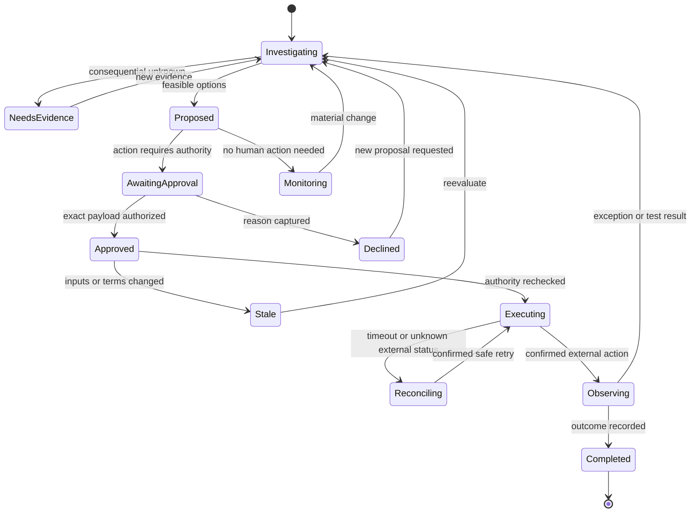

# Decision graph and loop rules

This is the target production graph. The fixture prototype implements proposed, investigating, approved, stale, declined, completed and the sample-result subflow. External execution states below remain backend work.

## Three loops, different purposes

Build loop: frozen feature contract → implementation → checks → bounded repair → evidence → commit → terminal state.

Business decision loop: inspect snapshot → significance → options → missing evidence/test → reevaluate → bounded proposal → approval/action → observed outcome.

Presentation loop: audience-filtered decision → eligible catalog → structural choices → deterministic plan → content slots → validation → trusted rendering or fallback.

The presentation loop never changes action authority. A larger reasoning model, Jev, and content filler are replaceable adapters; code enforces the invariants.

## Stop rules

Stop when the question is resolved, authority is absent, necessary evidence is unavailable, deadline/budget is exhausted, or the next step needs human judgment. Do not keep generating until a pleasing result appears.

One bounded copy repair is allowed after schema/content failure; then fallback. External retries need explicit policy and reconciliation. A submitted purchase may have succeeded after a timeout; never retry blindly.

## Attention

An event is not an interruption. Publish ambient state for routine progress. Notify the responsible person for a material change. Interrupt only when time-sensitive unresolved judgment warrants it. Product attention thresholds remain owner-confirmable policy, not model taste.

## Shared state

Server revision and decision version govern optimistic concurrency. Every approval names exact decision version, input snapshot, quote, actor, scope, expiry, and payload hash. Channel messages reference the same canonical decision. Changed facts supersede prior approvals and messages; they do not overwrite audit history.
